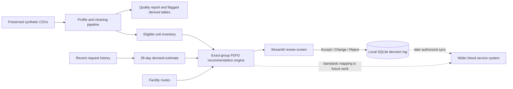

# Architecture

## Current workflow

1. Read synthetic CSVs from `data/raw/`.
2. Preserve every source record and produce quality flags / normalized derived data.
3. Estimate seven-day demand from a trailing 28-day mean. A rolling backtest compares it with the trailing 7-day mean baseline.
4. Exclude units unless status is explicitly in stock, the donation screen is explicitly non-reactive, expiry is valid at the snapshot, blood group is known, cold-chain flags pass, and location is confirmed.
5. Rank exact component and group matches by earliest expiry (FEFO); show route time and source surplus.
6. Let a named reviewer Accept, Change, or Reject and record that choice locally.

The current prototype does not dispatch blood, authenticate roles, synchronize across devices, connect to a lab or hospital system, or map to a healthcare standard. Future integration should map facility identifiers and unit identifiers to the relevant national system and standards after expert review; this demo does not claim FHIR, ISBT 128, or DHIS2 conformance.

